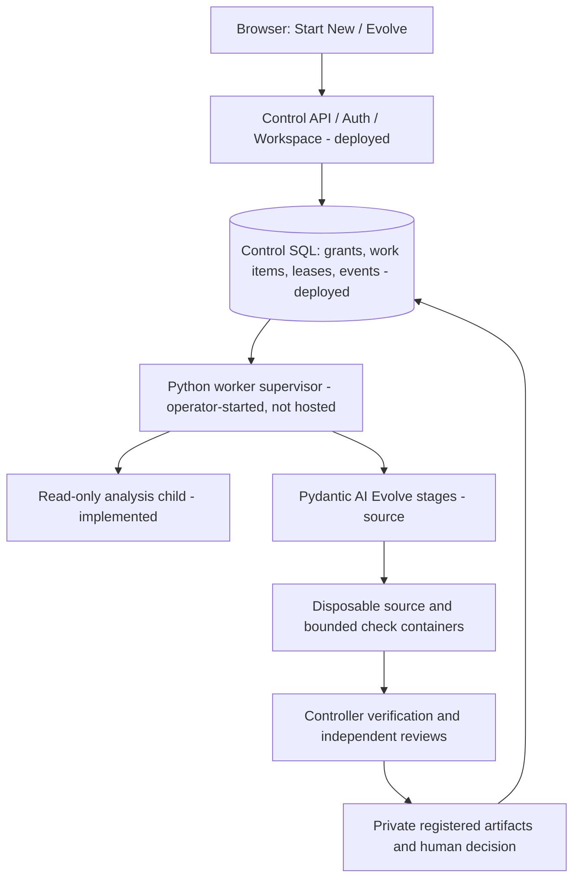

# Technical architecture and component choices

Oryveta is an open-source software delivery workspace being built toward an AI software factory. Its near-term audience is small teams maintaining existing codebases, with the initial qualification cohort being Python services. This page separates the parts that run today from the planes the factory still needs. For the single current-state summary read [STATUS.md](STATUS.md); this page describes structure and boundaries rather than restating dated evidence.

## Architectural principle

Keep three replaceable planes: **control**, **intelligence**, and **execution**. Every external provider should sit behind a versioned adapter. Start with a small single-host implementation, then distribute only where measured demand justifies complexity.

## Implemented today

**Hosted site:** Vercel builds `apps/web/studio` as the React/shadcn product UI. Hosted Supabase identity/workspaces and the self-hosted FastAPI engine are separate; the hosted UI does not call local jobs.

**Collaboration:** Supabase-backed project briefs, explicit project membership and separate private-session grants are deployed. Sign-in is identity, not project/repository authority. Production GitHub sign-in and multi-user project/private-session authorization are verified in [STATUS.md](STATUS.md); they do not grant code-execution privileges.

**Self-hosted compatibility:** FastAPI retains legacy `/` plus `/studio/` for the built React distribution. SQLite users/projects/jobs/events support deterministic starter creation, ZIP snapshot import, read-only heuristic analysis and a coarse queued/running/succeeded/failed/canceled worker lifecycle. This engine has its own local identity; hosted Supabase sessions are never forwarded into it and no hosted bridge exists.

**Durable analysis control plane (deployed; worker hosting pending):** production Supabase stores project-authorized work items, leases, bounded attempts, checkpoints, cancellation and pinned sources. Browser submission, a real public-repository analysis and result download were verified with a separately authenticated one-off local worker. The database is deployed, but no always-on cloud worker is configured; continuous execution still requires an authorized host and worker registration.

**Protected repair library and standalone CLI:** `coding_runtime` retains operator-selected ZIP repair and model-free candidate re-verification. Edits occur in a disposable local copy; checks run in fresh networkless, non-root containers under fixed operator policy. The new Reviewed Evolve worker reuses these functions rather than introducing a second execution engine.

**Reviewed Evolve (working-tree source):** Pydantic AI provides typed, read-only planning/reviewer/audit/learning roles over pinned local Ollama inference. The existing PostgreSQL work/run/lease system admits stages, records reviews, registers private Storage artifacts and holds exact-candidate human approval. Failed checks and rejected reviews cannot be promoted; failure learning is diagnostic and unavailable inference is explicit. This is not an operated hosted coding service or proven isolation for arbitrary customer workloads.

## Planned production control plane

- Retain the existing React/shadcn UI and Python/FastAPI engineering code; do not rewrite runtimes to add the factory.
- Supabase Auth supplies the hosted principal. PostgreSQL owns explicit workspace/project/session grants, durable work and evidence metadata. A self-hosted deployment is an alternative, not a second identity authority.
- GitHub App permissions are separate from human sign-in. Slack/mobile clients use the same authorization and work-item contract.
- A small Python orchestrator owns durable admission, leases, bounded attempts, cancellation, checkpoints and side-effect reconciliation.
- Browser clients never receive worker, GitHub App or database service credentials. Large evidence artifacts live outside SQL with scoped metadata.

## Planned execution plane

Reviewed Evolve now joins durable project admission to the bounded repair/verifier library and releases its execution lease while awaiting a person. Production hosting, stronger isolation for arbitrary customer code, automated customer-cloud provisioning, fair admission at scale and availability/recovery qualification remain deployment gates. Start with supervised workers and one state authority; add services only for measured constraints. A shared-kernel Docker container is not a tenant boundary.

## Planned intelligence plane

Implemented source includes the pinned local Ollama adapter, Pydantic AI schema-constrained roles and exact-source/configuration lesson retrieval. Adaptive routing, a general knowledge graph, model training and self-modifying harness promotion remain planned. Native tool calls remain limited to the bounded code editor; reviewers have no action tools. Model inference uses operator-provisioned compute, with no paid provider fallback.

## Target data flows

Start New still stops at a brief and deterministic starter. Read-only analysis remains available separately. Reviewed Evolve source now connects an authorized project goal to durable stages, a bounded candidate, independent checks/reviews, human approval and scoped learning. Its result is an approved archive, not a GitHub PR or deployment; those remain part of the target flows below.

Start New (target): authenticated brief → persisted specification/plan → approved task DAG → sandbox workspace → code/test/build → evidence artifacts → reviewable source/PR → user-approved deployment.

Evolve (target): authorized repo snapshot → architecture map + static/runtime diagnostics → ranked opportunities → bounded change in isolated branch → independent tests → review/PR → measured result.

## Architecture diagram

This shows source components and their deployment boundaries. Production has collaboration and durable analysis. The Reviewed Evolve connections require the new migration, Storage and a provisioned worker; no production coding rollout is claimed.

## Key boundaries

Models cannot grant permissions. Repository content is untrusted input. Local SQLite is the local engine's single-host store, not a shared cross-host WAL database and not a second hosted identity authority; Supabase PostgreSQL is the one hosted authority, and D1 or another queue/broker is not part of this path. Database rows are not storage for model weights and large logs; the local CLI's receipts, traces, patches and candidate archives stay in private operator-owned files outside both databases. One $0 VM cannot guarantee unlimited agents, GPU time, or enterprise uptime.
