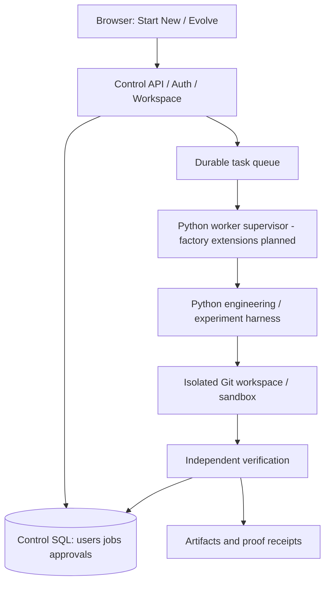

# Technical architecture and component choices

Oryveta is an open-source software delivery workspace being built into an AI software factory. This page separates the parts that run today from the planes the factory still needs.

## Architectural principle

Keep three replaceable planes: **control**, **intelligence**, and **execution**. Every external provider should sit behind a versioned adapter. Start with a small single-host implementation, then distribute only where measured demand justifies complexity.

## Implemented today

**Hosted site:** Vercel builds `apps/web/studio` as the React/shadcn product UI. Hosted Supabase identity/workspaces and the self-hosted FastAPI engine are separate; the hosted UI does not call local jobs.

**Collaboration:** Supabase-backed project briefs, explicit project membership and separate private-session grants are deployed. Sign-in is identity, not project/repository authority. Production GitHub sign-in and multi-user project/private-session authorization are verified in [STATUS.md](STATUS.md); they do not grant code-execution privileges.

**Self-hosted compatibility:** FastAPI retains legacy `/` plus `/studio/` for the built React distribution. SQLite users/projects/jobs/events support deterministic starter creation, ZIP snapshot import, read-only heuristic analysis and coarse queued/running/succeeded/failed/canceled worker lifecycle. No hosted bridge, sandboxed arbitrary execution or autonomous coding agent exists.

**Durable analysis control plane (deployed; worker hosting pending):** production Supabase stores project-authorized work items, leases, bounded attempts, checkpoints, cancellation and pinned sources. Browser submission, a real public-repository analysis and result download were verified with a separately authenticated one-off local worker. The database is deployed, but no always-on cloud worker is configured; continuous execution still requires an authorized host and worker registration.

## Planned production control plane

- Retain the existing React/shadcn UI and Python/FastAPI engineering code; do not rewrite runtimes to add the factory.
- Supabase Auth supplies the hosted principal. PostgreSQL owns explicit workspace/project/session grants, durable work and evidence metadata. A self-hosted deployment is an alternative, not a second identity authority.
- GitHub App permissions are separate from human sign-in. Slack/mobile clients use the same authorization and work-item contract.
- A small Python orchestrator owns durable admission, leases, bounded attempts, cancellation, checkpoints and side-effect reconciliation.
- Browser clients never receive worker, GitHub App or database service credentials. Large evidence artifacts live outside SQL with scoped metadata.

## Planned execution plane

Extend the existing Python worker with disposable isolated execution, scoped tool capabilities and an independent verifier. Persist run/checkpoint state outside the runner and release compute while awaiting a person. No Rust supervisor, Hono API or additional queue platform is required for this delivery path; introduce another service only for a measured constraint. Worktrees alone are not isolation for untrusted customer code.

## Planned intelligence plane

Python research/coding harness, scikit-learn/AutoGluon/CatBoost/LightGBM/XGBoost/Optuna for ML benchmarks; Tree-sitter/language tools for code structure; prompt/model adapters to Ollama/llama.cpp/vLLM and optional customer-configured providers; policy engine, verifier, versioned context retrieval and memory.

## Target data flows

Both flows are the factory target, not current behavior. Today Start New stops at a brief plus a deterministic starter, and Evolve stops at authorized snapshot intake plus read-only analysis.

Start New (target): authenticated brief → persisted specification/plan → approved task DAG → sandbox workspace → code/test/build → evidence artifacts → reviewable source/PR → user-approved deployment.

Evolve (target): authorized repo snapshot → architecture map + static/runtime diagnostics → ranked opportunities → bounded change in isolated branch → independent tests → review/PR → measured result.

## Architecture diagram

## Key boundaries

Models cannot grant permissions. Repository content is untrusted input. Local SQLite is not a shared cross-host WAL database. Database rows are not storage for model weights and large logs. One $0 VM cannot guarantee unlimited agents, GPU time, or enterprise uptime.
