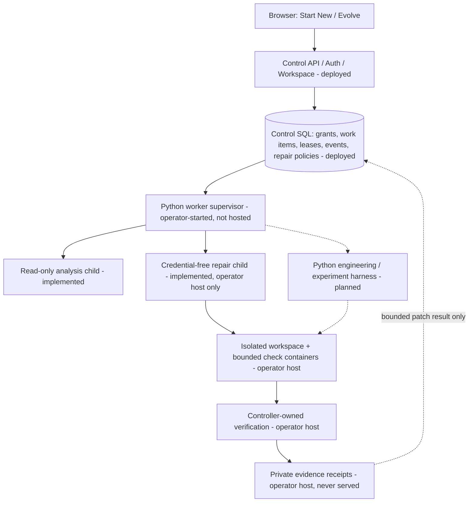

# Technical architecture and component choices

Oryveta is an open-source software delivery workspace being built toward an AI software factory. Its near-term audience is small teams maintaining existing codebases, with the initial qualification cohort being Python services. This page separates the parts that run today from the planes the factory still needs. For the single current-state summary read [STATUS.md](STATUS.md); this page describes structure and boundaries rather than restating dated evidence.

## Architectural principle

Keep three replaceable planes: **control**, **intelligence**, and **execution**. Every external provider should sit behind a versioned adapter. Start with a small single-host implementation, then distribute only where measured demand justifies complexity.

Keep **work state**, **observer state**, **verification** and **publication/approval** distinct. Request-generation guards protect browser intent; transaction-local authorization and lease predicates protect durable work. A failed read is not missing data, and a verified candidate is not permission to publish. The [state-machine inventory and lifecycle contract](STATE-MACHINES.md) names the existing owners and transitions across all application surfaces; it does not introduce a global state store or another workflow runtime.

## Implemented today

**Hosted site:** Vercel builds `apps/web/studio` as the React/shadcn product UI. Hosted Supabase identity/workspaces and the self-hosted FastAPI engine are separate; the hosted UI does not call local jobs.

**Collaboration:** Supabase-backed project briefs, explicit project membership and separate private-session grants are deployed. Sign-in is identity, not project/repository authority. Production GitHub sign-in and multi-user project/private-session authorization are verified in [STATUS.md](STATUS.md); they do not grant code-execution privileges.

**Self-hosted compatibility:** FastAPI retains legacy `/` plus `/studio/` for the built React distribution. SQLite users/projects/jobs/events support deterministic starter creation, ZIP snapshot import, read-only heuristic analysis and a coarse queued/running/succeeded/failed/canceled worker lifecycle. This engine has its own local identity; hosted Supabase sessions are never forwarded into it and no hosted bridge exists.

**Durable analysis control plane (deployed; worker hosting pending):** production Supabase stores project-authorized work items, leases, bounded attempts, checkpoints, cancellation and pinned sources. Browser submission, a real public-repository analysis and result download were verified with a separately authenticated one-off local worker. The database is deployed, but no always-on cloud worker is configured; continuous execution still requires an authorized host and worker registration.

**Local model-driven repair and model-free reverification (one-shot operator CLI):** `python -m oryveta_engine.coding_runtime` performs model-driven edits of an operator-selected ZIP inside a disposable copy, under a versioned operator specification, exact file allowlists, a pinned local Ollama model and bounded Docker check execution, and emits a review candidate plus private evidence. The same command re-verifies a supplied candidate archive without any model contact. Two distinct boundaries matter here and are frequently conflated: **model-driven file edits** happen only in the local disposable workspace, while **check execution** happens in fresh, networkless, non-root containers that the model cannot configure. This is local defense in depth, not multi-tenant production isolation, and this command is not hosted, queued or autonomous. See [IMPLEMENTATION.md](IMPLEMENTATION.md#local-verified-repair-cli).

**Controlled durable repair (source; operator-hosted worker, no hosted execution):** a second task kind on the same durable control plane admits `repository_repair` work against an operator-enrolled policy that binds one project, one dedicated worker Auth identity, one public GitHub commit and one reviewed configuration digest. `python -m oryveta_engine.coding_worker` polls for that work independently of any browser and supervises the same `coding_runtime` repair loop in a credential-free child, publishing one bounded `needs_review` patch result. This closes the queue/lease/report gap for repair, but it does **not** make execution hosted: the worker, the Docker daemon, the Ollama endpoint and all private evidence are on a Linux host the operator provisions and supervises. No cloud worker is provisioned and nothing approves, merges or deploys a candidate. See [OPERATIONS.md](OPERATIONS.md#controlled-durable-repair-operations).

There is no Oryveta-operated service that executes repository code, no hosted autonomous Evolve fix, no sandboxed execution of arbitrary customer code and no unattended coding agent beyond an operator-supervised worker bound to one approved policy.

## Planned production control plane

- Retain the existing React/shadcn UI and Python/FastAPI engineering code; do not rewrite runtimes to add the factory.
- Supabase Auth supplies the hosted principal. PostgreSQL owns explicit workspace/project/session grants, durable work and evidence metadata. A self-hosted deployment is an alternative, not a second identity authority.
- GitHub App permissions are separate from human sign-in. Slack/mobile clients use the same authorization and work-item contract.
- A small Python orchestrator owns durable admission, leases, bounded attempts, cancellation, checkpoints and side-effect reconciliation.
- Browser clients never receive worker, GitHub App or database service credentials. Large evidence artifacts live outside SQL with scoped metadata.

## Planned execution plane

The operator-run local CLI already supplies a disposable workspace, scoped tool capabilities, bounded isolated check execution and controller-owned verification for one fixed single-agent repair policy, and the controlled repair worker now admits that same loop from the durable work contract rather than only from an operator's shell: run state, leases, bounded attempts, cancellation, fencing and a bounded result live in the control plane. What remains planned is making execution itself *hosted*: compute the project owns rather than the operator, compute released while awaiting a person, and per-tenant isolation strong enough for untrusted customer code. No Rust supervisor, Hono API or additional queue platform is required for this delivery path; introduce another service only for a measured constraint. Worktrees alone are not isolation for untrusted customer code, and a shared-kernel Docker container is not a per-tenant boundary.

## Planned intelligence plane

Planned, with one exception: the pinned local Ollama tool-model adapter used by the operator-run repair CLI and the text-only local gateway both exist. Still planned are the Python research harness beyond small scikit-learn baselines; scikit-learn/AutoGluon/CatBoost/LightGBM/XGBoost/Optuna for ML benchmarks; Tree-sitter/language tools for code structure; llama.cpp/vLLM and customer-configured provider adapters; a policy engine, versioned context retrieval and memory. Model inference always runs on compute the user supplies; no paid provider or hosted inference key is enabled.

## Target data flows

Both flows are the factory target, not current behavior. Today Start New stops at a brief plus a deterministic starter. Evolve stops at authorized snapshot intake plus read-only analysis for the general product; its only change-producing paths are the one-shot operator CLI, which is not reachable from a brief, a project or any endpoint, and the controlled repair policy, which is project-scoped and submittable from the browser but executes only on an operator-provisioned host and returns a patch for review rather than a branch, a PR or a deployment.

Start New (target): authenticated brief → persisted specification/plan → approved task DAG → sandbox workspace → code/test/build → evidence artifacts → reviewable source/PR → user-approved deployment.

Evolve (target): authorized repo snapshot → architecture map + static/runtime diagnostics → ranked opportunities → bounded change in isolated branch → independent tests → review/PR → measured result.

## Architecture diagram

The diagram is the **target** topology. Deployed today: the browser, the control API/auth/workspace and the control SQL, with durable work items, leases and repair policies in that same PostgreSQL authority rather than a separate queue platform. The worker supervisor runs only when an operator starts it, on a host the operator owns. The isolated workspace, independent verification and private receipts likewise live on that operator host for both repair paths; the difference is reporting. The controlled repair worker returns bounded numeric progress and one bounded patch result to the control plane, so the queue, lease and result arrows below are real for that kind. The one-shot CLI reports nothing to any control plane, and no part of either path is hosted execution.

## Key boundaries

Models cannot grant permissions. Repository content is untrusted input. Local SQLite is the local engine's single-host store, not a shared cross-host WAL database and not a second hosted identity authority; Supabase PostgreSQL is the one hosted authority, and D1 or another queue/broker is not part of this path. Database rows are not storage for model weights and large logs: both repair paths keep their receipts, traces, prompts, candidate archives and private expected values in operator-owned files outside both databases, and the controlled path persists only a bounded result — the untruncated patch, the identities it was computed from and bounded counts — with an over-limit patch refused rather than truncated. One $0 VM cannot guarantee unlimited agents, GPU time, or enterprise uptime.
