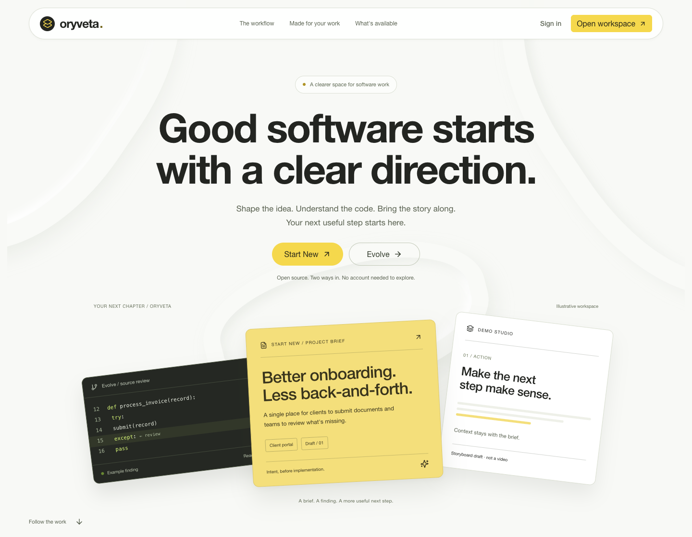
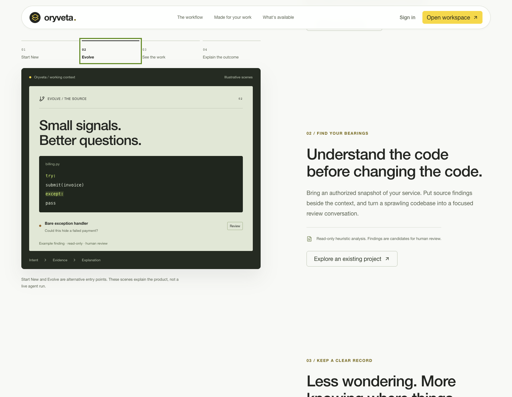
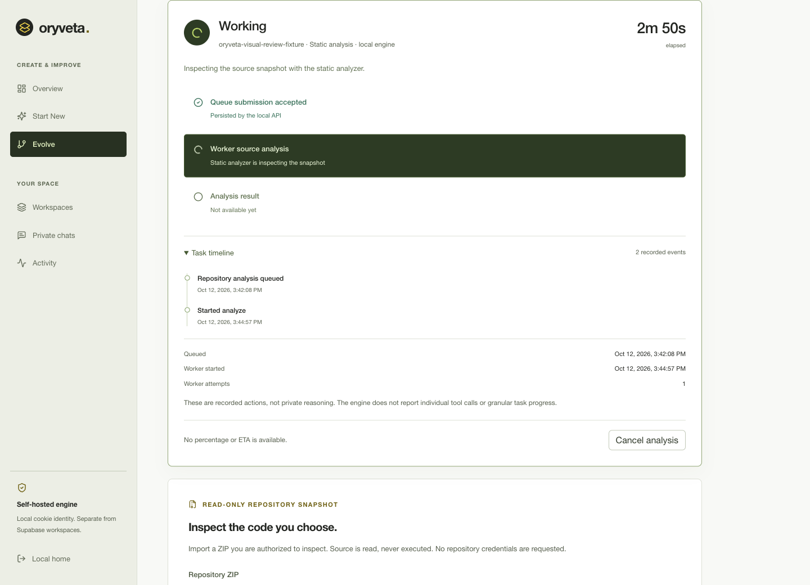

# Oryveta Studio — clear direction

This redesign supersedes the previous Soft Modern direction. The primary visual reference is the public **Galileo** preview: a bright material-like canvas, centered bold sans-serif hierarchy, a yellow primary action, and large product imagery. Oryveta's relief loops, brief, source finding and storyboard are original CSS/HTML artwork. No paid template source, sphere assets, brand marks, waitlist claims, countdowns or customer metrics are reused.

## Reference synthesis

Public previews were inspected in Chromium on 2026-10-12, not just read as sales descriptions:

- [Galileo](https://galileo.shadcn.io): primary light/sculptural composition, centered hierarchy and yellow action. The original Oryveta context loops are lightweight CSS, not copied geometry or WebGL.
- [Reframe](https://reframe.shadcn.io): oversized typography, generous space and product artwork carrying the page. Its blue CTAs, customer logos and showcase assets are not copied.
- [Lightbox](https://lightbox.shadcn.io): contrast and process-oriented section hierarchy. Its purple/cyan ribbon, branding and agency content are not copied.
- [Solaris](https://solaris.shadcn.io): product-proof framing and technical diagrams. Oryveta shows its own brief/source/story semantics, not fictional hosted agent capabilities or dashboard metrics.
- [Catalogue](https://www.shadcn.io/template) / [Prodexa](https://prodexa.shadcn.io): the transition from product-focused marketing to a calmer working interface, without floating people/cursor decorations.

These are reference observations, not claims about the templates' animation implementations or licenses. Historical ShadcnStore attribution remains intact; see [THIRD_PARTY.md](../apps/web/studio/THIRD_PARTY.md).

## Tokens and typography

| Token | Value | Role |
| --- | --- | --- |
| Canvas | `#F8F9F6` | Bright neutral page |
| Ink | `#232521` | Headings and dark technical surfaces |
| Muted | `#58604F` | Secondary readable text |
| Signal | `#F5D84C` | Primary actions and selected details |
| Border | `#DCE0D5` | Quiet dividers |

The deliberately **system-font** stack is Helvetica Neue, Helvetica, Arial, sans-serif. No unshipped Inter assumption or external font request. Main hero type uses restrained `-.035em` tracking; mobile uses `-.03em`. Forms use solid, labeled fields and visible focus. Status green/red remains semantic, not a decorative success claim.

## Composition and motion

- The centered hero places an original dimensional context backdrop behind large type. A brief, code finding and storyboard form the product artwork. All are explicitly illustrative.
- Hero artwork has one short spring entrance from a visible state; the brief gently responds to native scroll. No loading splash, looping ornament, scroll hijack or simulated job completion.
- A sticky evidence stage retains four sheets in one composition. Scroll position directly transforms their translation, rotation and scale rather than just swapping faded text. Each actual chapter's geometry determines the active sheet, including unequal heights and zoom. Four keyboard-operable controls provide direct navigation.
- Use cases form an open dark spread; capabilities use rules and whitespace rather than repeated floating cards. The workspace carries quieter neutral surfaces, one yellow action vocabulary, stronger forms and a clear contextual Demo Studio stage.
- Buttons/cards use restrained spring-like hover and press responses. Real run panels use Motion size-layout transitions; native task-timeline disclosure uses progressive CSS size interpolation (immediate native fallback in browsers without support). State and elapsed values still come only from the API.
- **Motion 14.1.0**, MIT, is the only added runtime library. It is pinned in package.json and package-lock.json. CI installs the lock using `npm ci`.

## Accessibility and responsive behavior

Native document scrolling, labeled forms, skip links, visible focus, Radix keyboard tabs and the native workspace dialog remain. Mobile menu Escape returns focus to its trigger. Mobile sheets keep receipts in frame; short viewports use non-sticky narrative content.

Reduced motion is a live `matchMedia` subscription, including preference changes while the page is open. Motion 14's own hook snapshots on mount, so the small shared hook uses React's `useSyncExternalStore`. Reduced mode removes scroll transforms and spring entrances, keeps the selected sheet fully visible, and preserves keyboard chapter selection. CSS disables continuous indicators, transitions and hover movement. No essential content depends on animation.

## Product contracts preserved

**Start New** and **Evolve** are the only work starts. Each has Brief, Local run and contextual Demo Studio tabs. There is no standalone Demo entry or fallback to another journey's story. Brief/scene/tab drafts remain scoped to their workspace and journey within the mounted workspace, not persisted across reload/sign-out. Storyboard exports keep `storyboard_only_not_rendered`, `verified: false`, and exact journey/brief/project context.

Hosted Supabase identity/workspaces/private human chats remain separate from the self-hosted same-origin `/studio/` cookie/CSRF API. Hosted preview has no coding engine. Local users can create deterministic starters, export ZIPs, import authorized snapshots and request read-only static analysis. Imported code is never executed; findings do not prove security/correctness or apply patches. Legacy `/` remains intentionally supported.

Run status is persisted queued/running/succeeded/failed/canceled truth. The UI retains one elapsed label, actual event records, stale/disconnected behavior, owner-bound selections and user-opened details across polls. Lifecycle rows mean queue acceptance, source analysis and result persistence only. No percentages, ETAs, invented tool counts, fine-grained agent steps or private reasoning. Latest project findings remain distinct from an older selected run.

## Visual evidence

Intentional PR assets are local browser captures of this implementation, not deployment or customer-execution claims:

The landing/story images are explicitly illustrative. The local-run capture uses an isolated synthetic repository and real persisted worker state; it is not a performance benchmark, application-test result or security certification. Exact runtime checks and their limitations belong in the PR verification report.
