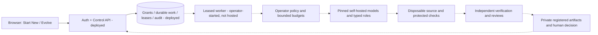

# Enterprise-first AI engineering architecture

**Scope:** Release gates for Oryveta's Start New and Evolve workflows. Proposed components are not shipped features; this document is not a claim of enterprise certification.

## Invariants

1. **Separate control, intelligence and execution.** The API owns identity, policy, budgets and job state. Untrusted repository commands must run in isolated, disposable sandboxes, never in the API process.
2. **Models cannot grant permissions.** Every tool capability is explicitly allowed, approved where needed, and scoped to the authenticated account, repository and operation. Repository text and model output are untrusted.
3. **Independent verification is mandatory.** The code-writing agent cannot certify its own output. Use externally specified tests, held-out evaluations, reproducible artifacts and proof receipts.
4. **Every task has bounds.** Per-user admission, execution deadline, token and compute budget, retry limit, artifact limit and explicit cancellation.
5. **Every action is traceable.** Record correlation IDs, code revision, model/tool versions, approval, budgets, tests and evidence. Do not log secrets or sensitive prompts by default.
6. **Every state change is durable and idempotent.** Lease fencing prevents stale workers from publishing; transactional event writes prevent orphaned activity records. External side effects need reconciliation before retries.
7. **Portability beats premature distribution.** Keep the Python/SQLite local engine and use the existing Supabase/PostgreSQL authority for hosted collaboration. Add queues, runtimes or orchestration services only for measured requirements; do not introduce parallel identity/data systems.

## Architecture

Solid edges identify deployed service boundaries, not uptime guarantees. Dotted edges describe operator-provisioned execution: Reviewed Evolve source now reports to the control plane, but no operated cloud coding deployment or enterprise isolation claim follows from that.

**Implemented and deployed:** Supabase Auth identity, PostgreSQL RLS project/session grants, narrow write RPCs, durable work items with fenced leases, bounded attempts, checkpoints, cancellation, worker revocation and typed run events. Production analysis has been completed only by an operator-started one-off local worker.

**Implemented self-hosted or local only:** the single-host SQLite job admission/cancellation/lease path, local heuristic source analysis, read-only Evolve patch previews, the opt-in local Ollama text adapter with SQLite per-user token reservations, and the operator-run repair/reverification CLI with its versioned specification, scoped file allowlists, bounded container check execution, controller-owned verification and durable private receipts.

**Still unimplemented or unqualified for production:** operated hosted coding/modernization, automated customer-cloud provisioning, hardened per-tenant execution for arbitrary code, a general knowledge graph, on-call automation, GitHub App publication, self-modifying learning, enterprise identity governance, billing and operational guarantees. Reviewed Evolve's supervised worker and scoped lesson registry exist in source; local Docker checks and project/session RLS are not comprehensive enterprise assurance.

## Enterprise AI release gates

| Foundation | Required contract | Proof before enabling |
| --- | --- | --- |
| Model adapter | Versioned model/tool interface with bounded inputs, outputs and execution | Real approved-model task, failure/denial behavior and independent outcome verification; mocks alone are not proof |
| Security | Explicit capability allowlist, secrets isolation, GitHub App least privilege | Prompt-injection and authorization adversarial tests |
| Sandbox | Ephemeral filesystem, non-root, CPU/memory/wall limits, controlled egress | Escape/egress tests, kill and cleanup on timeout |
| Evaluation | External acceptance tests and independent reviewer | Held-out success metrics and regression rejection |
| Human approval | Scope-matched approval for push, PR, deploy and destructive changes | No side effect without approval |
| Cost controls | Token/compute limits, parallelism quotas, circuit breakers | Budget exhaustion hard-stop tests |
| Observability | Correlation IDs across API, worker, model, tools, verifier | End-to-end traces without credentials |
| Tenant isolation | Organization/workspace scoped data and artifacts | Cross-tenant SQL, storage and queue tests |
| Operations | Backup/restore, rollback, reproducible deploy | Restore drill and canary rollback |
| Delivery | CI, dependency audit, code review, artifact provenance | Required checks green before merge |

Nothing in that table is satisfied for a hosted multi-tenant launch. Two rows have *partial local* evidence that must not be read as the gate being met: a real local open-weight model completed one synthetic repair with independent controller-owned verification (Model adapter), and the local check runner enforces an ephemeral filesystem, non-root UID, CPU/memory/PID/output limits, disabled networking and kill/cleanup on timeout (Sandbox). Both were exercised on one operator's own machine against operator-approved source and a trusted image. Shared-kernel containers on a trusted host are not escape-tested per-tenant isolation, and one synthetic task is not held-out success evidence.

## Task state and current limitations

Current single-host lifecycle: `queued → running → succeeded | failed`; `queued | running → canceled`. A worker has a unique lease token, renews it while busy and can commit results only with an unexpired matching token. Cancellation revokes the token atomically, preventing late results or retries. **Running computation can still finish in-process**: this is a persistence fence, not hard termination, and it is the reason the web/API path still only reads imported source. The separate local repair CLI does have bounded container execution with hard per-command deadlines and verified teardown, but it is operator-run on trusted source and is not this lifecycle. Do not execute untrusted customer code on either path.

A user can have at most **8 queued/running jobs** on the current single-host API. New requests over quota return `429` and `Retry-After: 30`. Matching benchmark idempotency replays work at capacity. Initial imported project and analysis job are inserted atomically, avoiding orphan rows on quota rejection. Job admission and activity records share a transaction.

- `GET /api/jobs/{job_id}`: sanitized, owner-only status; no lease tokens.
- `POST /api/jobs/{job_id}/cancel`: owner-only, CSRF-protected; idempotent if already canceled; terminal success/failure returns `409`.

## What to measure

- **Reliability:** queue wait p50/p95, completion rate, retry and expired lease rate, cancellation latency, worker recovery.
- **AI quality:** held-out verified success rate, regressions, cost per verified outcome, verifier agreement.
- **Security:** cross-tenant denials, tool permission violations, secret leaks, sandbox escapes.
- **Economics:** tokens, CPU/GPU seconds and storage per task and per tenant.
- **Operations:** latency p95/p99, database contention, backup restore time, rollback time.

Scale only when evidence demands it: shared SQL for multi-host writes, a durable queue for host-loss recovery, multiple isolated workers for actual parallel demand. Green CI is necessary but not a load test, SLA or security certification.

## Next implementation order

Use the canonical [PR roadmap](ROADMAP.md), not a second parallel implementation sequence. Resource authorization is foundational. Durable execution, isolated tools, GitHub access and the knowledge graph precede full Evolve; modernization and on-call reuse that same verified engine. Enterprise identity integrations and operated launch gates do not defer baseline security to the end.

See [QUALITY.md](QUALITY.md), [AUTH-SECURITY.md](AUTH-SECURITY.md), [ROADMAP.md](ROADMAP.md) and [OPERATIONS.md](OPERATIONS.md).

## Enterprise completion criteria

“Enterprise-ready” is an evidence threshold, not a UI style or a claim derived from passing a small auth suite. Each launch contract names the relevant requirements, operational owner and evidence:

| Area | Required enterprise evidence |
| --- | --- |
| Identity and lifecycle | Real sign-in/session recovery, required MFA/federation/provisioning, service identity rotation and deprovisioning/revocation across UI, APIs and workers |
| Tenant and data isolation | Negative tests across projects, private sessions, graph retrieval, logs, evidence, previews, caches and integration destinations; no permission inherited merely from a Slack channel |
| Secure execution | Adversarial code cannot reach host credentials, another tenant or unauthorized networks; enforced process/resource limits and reliable cancellation |
| Modernization | Contract/consumer and data migration checks, approved breaking changes, performance/AI-quality gates, rollout/rollback and decommissioning evidence |
| On-call | Genuine operational fault -> correlated reports -> scoped session -> cited diagnosis -> verified fix -> authorized release -> observed recovery; storm and false-correlation tests |
| Governance and audit | Attributable actions/approvals, protected audit records, provenance, retention/deletion and exports; hashes alone are not proof of truthful execution |
| Supply chain | Dependency/model/recipe licenses and provenance, vulnerability checks, pinned releases where practical and no unapproved managed-service redistribution |
| Reliability | Agreed SLO/RPO/RTO, backup/restore and failure-recovery drills, monitored dependencies, human escalation and ownership when the agent platform itself fails |
| Learning | Trusted outcome inputs, protected holdouts, no unauthorized cross-tenant reuse, bounded experiments, reviewed activation and working rollback |
| User experience | Accessible web/mobile chat, stable streaming/history, real task/evidence states and unambiguous errors, approvals and escalation |
| Economics | Measured inference, execution, telemetry query/retention and storage use; quotas and backpressure; no implicit paid fallback |

Use the [NIST AI Risk Management Framework](https://www.nist.gov/itl/ai-risk-management-framework) to organize risk ownership and measurement, and [OWASP GenAI risks](https://genai.owasp.org/llm-top-10/) to guide adversarial tests for injection, disclosure, supply chain, poisoning, unsafe output, excessive agency and unbounded consumption. Following guidance is not a certification claim.

Open-source software and self-hosted models can remove mandatory license/API bills. They do not remove hardware, power, maintenance, backup or availability costs. Managed enterprise features and telemetry providers may have paid entitlements. A zero-new-service-bill pilot must remain functional within explicit capacity limits; it must not be sold as unlimited or contractually highly available without the supporting deployment.
